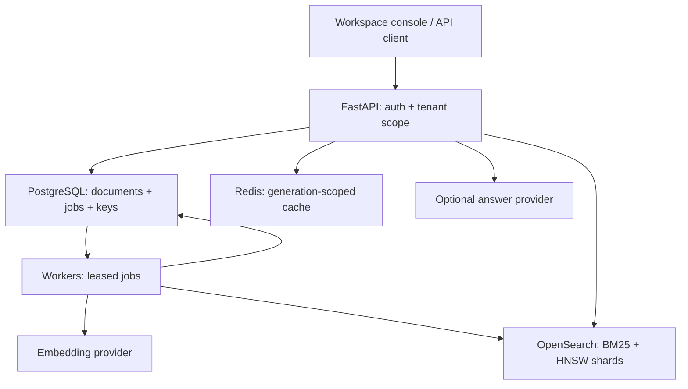

# Architecture and consistency

## Data flow

PostgreSQL is authoritative. The index and cache are projections. The local backend substitutes SQLite and a bounded Python BM25/vector implementation to exercise the same lifecycle without external services.

## Write and publication invariants

1. Authentication derives a tenant solely from a valid non-revoked API key. No endpoint accepts a caller-selected tenant ID for normal operations.
2. Tenant row locks serialize same-tenant mutations. `UNIQUE(tenant_id, external_id)` provides a second duplicate guard. This is intentionally conservative; it limits peak same-tenant write concurrency but still supports batch ingestion and parallel work across tenants.
3. A document revision and its job commit in one database transaction. There is no database/queue dual-write gap. The durable job table is the transactional work queue.
4. Workers claim with `FOR UPDATE SKIP LOCKED`, increment attempt count, and generate a unique lease token. PostgreSQL workers can claim different jobs concurrently. SQLite uses `BEGIN IMMEDIATE` and serializes transactions; it does not emulate distributed row locks.
5. Text is split into overlapping word windows and embedded in bounded provider batches. Chunk IDs are `document_id:revision:ordinal`, making retries idempotent.
6. OpenSearch bulk requests wait for refresh, and item-level failures prevent activation. Partial search/shard failures are rejected rather than returned as complete results.
7. Publication locks tenant, document, then job; verifies the current token, unexpired lease, and current document revision; activates the revision; increments tenant generation; and marks the job done atomically. A stale worker cannot publish.
8. Earlier active chunks remain searchable until publication. Cleanup happens after activation. If cleanup fails, the new revision remains valid and a maintenance sweep can remove old chunks.
9. Deletion clears canonical text, advances the document revision and generation, sets a tombstone, and queues index cleanup. Search rejects tombstoned documents even before cleanup succeeds.

This is **at-least-once processing with fenced publication**, not exactly-once external side effects. Crash/retry can repeat embeddings or index writes. Reclaimed attempts may reinsert old physical index records after cleanup; database validation hides those records and `gc` removes them. Never use a non-idempotent side effect in the worker without an additional idempotency design.

## Retrieval

Both OpenSearch branches apply tenant and optional collection filters. Lucene HNSW uses an inline k-NN filter so candidates are selected within the tenant/collection. Lexical search boosts title matches. The local mode implements BM25 over active chunks and cosine-like dot products over normalized vectors.

Each branch requests 100–500 candidates, depending on requested result count. Candidates are then checked against database document ownership, tombstones and `active_revision`. Reciprocal rank fusion sums `1 / (60 + rank)` across channels. The API returns one best-scoring chunk per document, up to the requested limit, with channel ranks and revision metadata.

This bounded over-fetch is a tradeoff: many inactive revisions or a few very long documents can exhaust the candidate budget and underfill results. Cleanup mitigates revision pollution; production relevance work should measure recall, tune candidate budgets, and consider grouped retrieval/reranking. Vector search returns nearest neighbors even for weakly related queries; there is no calibrated relevance threshold in this release.

## Consistency and caching

- Ingestion acknowledgment means durable acceptance; indexing is eventually consistent.
- An update may serve its previous active revision until the new revision is ready.
- Search confirms active visibility in PostgreSQL rather than trusting stale index metadata.
- Each cache key includes tenant ID, database generation, query, mode, limit and collection. Writes, deletes and publication increment generation.
- A query started after a deletion commit reads the new generation and cannot reuse pre-delete cached results. Queries already in flight may complete with their earlier view. The API is not linearizable across PostgreSQL and OpenSearch.
- Redis is not a correctness dependency. Cache outage falls back to a 256-entry process cache. Distributed rate-limit enforcement degrades to a per-process limit; a public deployment should also enforce gateway limits.

## Fault boundaries

| Failure | Behavior |
| --- | --- |
| Worker terminates before indexing | Lease expires; another worker retries |
| Worker terminates after partial bulk write | Deterministic chunk IDs allow safe retries |
| Worker terminates after indexing, before publication | Revision remains inactive until a valid attempt publishes |
| Late worker resumes | Lease token/revision checks reject publication |
| Embedding/index service fails | Retry delay grows; bounded failures become dead letters |
| Redis fails | Search continues with process-local caching/rate limiting |
| One OpenSearch node fails | Client tries another node; cluster replicas/quorum determine availability |
| PostgreSQL fails | Writes and authenticated search fail until database availability returns |
| Old index garbage remains | Results are filtered; recall may fall until cleanup |

Lease timestamps use system clocks. All API/worker/database hosts must have synchronized clocks; use NTP and monitor skew. Heartbeats cannot override fencing. Multi-region active-active processing is outside this release's guarantees.

## Sharding

OpenSearch assigns chunks to primary shards using document IDs. Replicas distribute reads and protect against node loss; three eligible managers allow quorum after one manager failure. The API client is configured with all three node endpoints. Primary shard count is chosen on index creation. Changing an environment variable does not repartition an existing index.

Tenant-filter fanout avoids a single hot shard per large tenant but costs cross-shard coordination. Very large tenants may justify dedicated indices, and small-tenant density should be load-tested. PostgreSQL documents/jobs are not partitioned in this release; use retention, indexing and measured table partitioning when data volume justifies it.

## Security scope

Keys carry read or write scope at the workspace boundary. Write access includes key lifecycle operations. No per-document ACL exists within a workspace. Keys are high-entropy tokens stored as hashes; provider secrets remain server-side. The console escapes all untrusted text, limits source links to HTTP(S), and uses a restrictive CSP. Upload bodies and extracted text are capped; PDF parsing is synchronous and should move to a resource-isolated extraction worker for hostile uploads at production scale.

The local Compose cluster disables OpenSearch security and uses development database credentials on an internal network. It is not suitable for public exposure. TLS, service credentials, SSO, external secret management, backup policy, audit export and gateway enforcement are deployment responsibilities.

## References

- PostgreSQL SELECT / SKIP LOCKED: https://www.postgresql.org/docs/current/sql-select.html
- OpenSearch efficient vector filtering: https://docs.opensearch.org/latest/vector-search/filter-search-knn/efficient-knn-filtering/
- OpenSearch vector field mapping: https://docs.opensearch.org/latest/mappings/supported-field-types/knn-vector/
